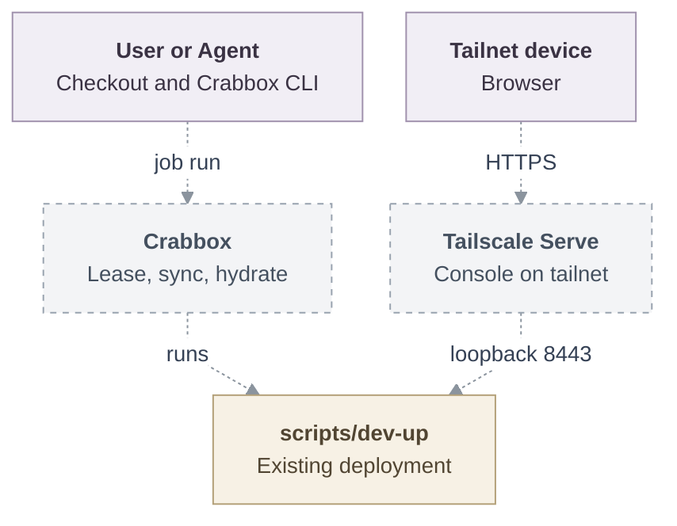
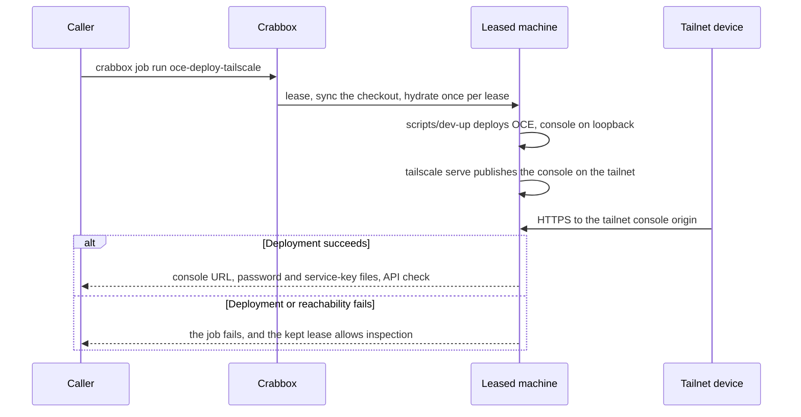

# Proposal: Deploy OCE with Crabbox

- **ID:** RFC-0019
- **Created:** 2026-10-12
- **Last updated:** 2026-10-13
- **RFC PR:** [#2](https://github.com/opencharly/openclaw-enterprise/pull/2)
- **Implementation plan:** [0019-crabbox-oce-deployment](../plans/0019-crabbox-oce-deployment.md)
- **Related:** [Local Kubernetes development](../../docs/guides/deploy/local-kubernetes-development.md)
  and [Crabbox](https://github.com/openclaw/crabbox)

## Summary

`crabbox job run oce-deploy` deploys OpenClaw Enterprise (OCE) from the caller's
checkout onto any machine [Crabbox](https://github.com/openclaw/crabbox) can
lease, a rented VPS included, and `oce-deploy-tailscale` publishes the console to
the tailnet. Crabbox supplies the machine, checkout and tools; `scripts/dev-up`
stays the deployment. One unattended command can therefore re-prove a deployment
on a fresh lease and attach its artifacts and test summary.

## Motivation

Users and developers often run OpenClaw on rented hosts and want OCE deployed the
same way, but OCE's current development deployment is local: the
[Local Setup](../../docs/guides/quickstart.md) guide runs it on a prepared
workstation and publishes the console on that machine's loopback. No other device
can currently reach that console, and there is no automatic way to run a
long-running test deployment.

Those users and developers need the same functionality on a remote host: one
command that deploys OCE onto a machine they already lease or own, a console that
every device on a secure network such as a tailnet can open, and a long-running
test deployment that runs unattended, repeats on demand, and doubles as its own
check.

## Goals

- One Crabbox job deploys OCE onto a machine with only Crabbox's prerequisites.
- One Crabbox job publishes the OCE console on the tailnet.
- The deploy job is unattended and repeatable, so a fresh lease re-proves a
  deployment instead of repeating one hand-driven run.

## Non-goals

- Changing what OCE's deployment scripts do, apart from the browser origin
  setting below.
- Agent native admin UIs over the tailnet: they need per-Agent wildcard
  hostnames, which a tailnet machine name cannot provide.

## Proposal

### Crabbox deployment

A repository-root `.crabbox.yaml` defines the deployment, owned by the repository
rather than by OCE. It carries two jobs over one pair of profiles — one deploying
with Crabbox's default reachability, one that also asserts the path the console is
published on — and both keep the lease (`stop: never`), take their prerequisites
from one `workflow_dispatch`-only hydration workflow, so OCE CI never runs it, and
run the same deployment through `scripts/dev-up`. A failed run therefore leaves
its lease standing for inspection, and the teardown preset below removes the
deployment. Any Crabbox SSH provider works: `ssh` for an existing host,
`proxmox`, `xcp-ng`, `incus`, `multipass`, `kubevirt`, `external`. The
configuration, the workflow and the ordered work are in the
[implementation plan](../plans/0019-crabbox-oce-deployment.md).

### Tailscale access

Crabbox's [Tailscale support](https://github.com/openclaw/crabbox/blob/main/docs/features/tailscale.md)
puts the machine on the tailnet; this RFC adds no join logic of its own.

- **Managed cloud leases** on a provider with Crabbox Tailscale support, such as
  `hetzner`, `aws`, `azure`, or `gcp`: the caller enables `tailscale.enabled`
  (`CRABBOX_TAILSCALE=1`). Crabbox installs Tailscale, joins with its default tags
  and `crabbox-{slug}` hostname, and logs the machine out on `crabbox stop`,
  best-effort while SSH is still reachable.
- **Existing hosts** on the `ssh` provider: the host is already on the tailnet,
  and `static.host` is its MagicDNS name. Self-hosted virtual machines join their
  tailnet this way, because Crabbox does not join `proxmox`, `xcp-ng`,
  `kubevirt`, `incus`, or `multipass` leases.

`network: tailscale` fails the job unless Crabbox reaches the machine over the
tailnet, so it only runs where the tailnet is already the path. Crabbox does not
use Tailscale Serve for its managed leases, so the job runs
`tailscale serve --bg --https=443 https+insecure://127.0.0.1:8443`, which
terminates TLS with the tailnet certificate and forwards to the existing loopback
console proxy, and passes the machine's tailnet origin to `dev-up`. The
`oce-tailscale` teardown preset resets Tailscale Serve.

### Console origin

That origin comes from one optional launcher setting,
`OCC_DEVELOPMENT_BROWSER_ORIGIN`: the tailnet origin with an explicit port,
`https://<machine>.<tailnet>.ts.net:443`, because the launcher refuses an origin
without one. When it is set, the launcher that `scripts/dev-up` invokes:

- uses it as `auth.baseUrl` in place of
  `https://console.<cluster>.oce.localhost:8443`;
- uses it as the Console origin it checks, and as the sign-in redirect host it
  derives today from `console.<cluster>.oce.localhost`;
- disables `agentNativeAdmin`;
- prints `<origin>/console/` as the console URL.

When it is unset, the launcher does not change. Credentials stay in the launcher's
state directory on the machine; Tailscale Serve publishes the console only on the
tailnet, never through Funnel, so tailnet ACLs and OCE sign-in both apply, and
Crabbox handles the Tailscale auth key without forwarding it to the job.

### Access

| Task    | Command                                                                                                                                                      |
| ------- | ------------------------------------------------------------------------------------------------------------------------------------------------------------ |
| Deploy  | `crabbox job run oce-deploy`, or `crabbox job run oce-deploy-tailscale`                                                                                      |
| Console | Open `https://<machine>.<tailnet>.ts.net/console/` on any tailnet device                                                                                     |
| Tunnel  | Without Tailscale: `crabbox tunnel --id <lease> --local-port 8443 8443`, then open `https://127.0.0.1:<local-port>/console/` with the development CA trusted |
| Sign in | `crabbox connect <lease>`, then read the administrator password file printed by the launcher                                                                 |
| CLI     | `crabbox run --id <lease> -- ./bin/occ namespace list`                                                                                                       |
| Remove  | `crabbox run --id <lease> --no-sync --profile <profile> --preset oce-teardown`, then `crabbox stop <lease>`                                                  |

### Architecture

Every arrow below is proposed; none of these connections exists today.

### Request lifecycle

Proposed: no step of this sequence exists today.

## Delivery and verification

Delivery is one launcher setting, the repository's Crabbox configuration and the
documentation those touch; the
[implementation plan](../plans/0019-crabbox-oce-deployment.md) owns its status,
orders the work and pairs each outcome with its check.

Required outcomes: a second device opens
`https://<machine>.<tailnet>.ts.net/console/` and signs in, while a device outside
the tailnet cannot reach it; the job refuses to run when Crabbox cannot reach the
lease over the tailnet; the launcher's API check answers on the lease; the
`oce-tailscale` teardown preset removes the deployment and resets Tailscale Serve.

Not yet verified: none of this has run. Reading establishes the Crabbox
configuration and the launcher's contracts, not that this stack comes up on a
leased machine; the plan's bare-VM run is the first proof, and the tailnet must
already serve HTTPS certificates for `tailscale serve --https=443`.

## Rationale and alternatives

- **Serve the console on a tailnet port with the development CA.** Every device
  would have to trust that CA, where Tailscale Serve uses the tailnet's own
  certificate.
- **A Crabbox-specific join script.** It would duplicate Crabbox's installation,
  auth key handling and logout, and would bypass `network: tailscale`.
- **Keep the local profile as the only deployment.** Teams keep preparing a
  workstation by hand, and the console stays on its loopback.

## References

- [Local Setup](https://docs-enterprise.openclaw.org/guides/quickstart/)
  ([source](../../docs/guides/quickstart.md)) and
  [Open the console from another machine](../../docs/guides/operate/troubleshooting.md#open-the-console-from-another-machine)
- [`scripts/dev-up`](../../scripts/dev-up) and
  [`scripts/ci/setup-tools.sh`](../../scripts/ci/setup-tools.sh)
- Crabbox: [repository](https://github.com/openclaw/crabbox),
  [jobs](https://github.com/openclaw/crabbox/blob/main/docs/features/jobs.md),
  [Actions hydration](https://github.com/openclaw/crabbox/blob/main/docs/features/actions-hydration.md),
  and [configuration](https://github.com/openclaw/crabbox/blob/main/docs/features/configuration.md)
- [Tailscale Serve](https://tailscale.com/docs/features/tailscale-serve)
