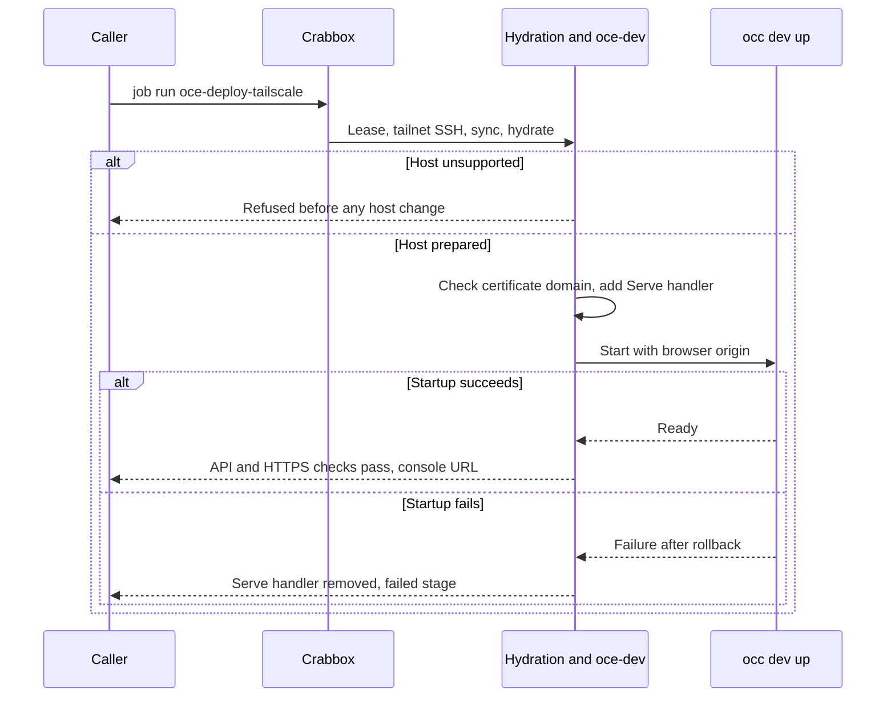

# Proposal: Deploy OCE development environments with Crabbox

- **ID:** RFC-0019
- **Created:** 2026-10-12
- **Last updated:** 2026-10-13
- **RFC PR:** [opencharly/openclaw-enterprise#2](https://github.com/opencharly/openclaw-enterprise/pull/2)
- **Implementation plan:** [RFC-0019 implementation plan](../plans/0019-crabbox-oce-deployment.md)
- **Related:** verified against Enterprise `3d180654c` and [Crabbox](https://github.com/openclaw/crabbox) `3d9260e7`

<a id="problem-and-decision"></a>

## Summary

Add three [Crabbox jobs](https://github.com/openclaw/crabbox/blob/3d9260e7a37e025ed36b3c38fbcf1ae50e4a3520/docs/features/jobs.md)
that run OpenClaw Enterprise (OCE)'s existing Kubernetes-only development profile
on a remote Linux host:

- `oce-deploy` prepares the host and starts the profile.
- `oce-deploy-tailscale` also serves the console on the host's tailnet HTTPS name.
- `oce-teardown` removes everything the other two jobs created.

The only product change is an optional launcher setting,
`OCC_DEVELOPMENT_BROWSER_ORIGIN`, which tells the installation which browser
origin to accept.

## Motivation

Contributors want a development installation on a cloud lease or on a server
they own, and they want to open its console from their own devices.
[Local Setup](../../docs/guides/quickstart.md) assumes a machine that is already
prepared, and it serves the console only on that machine's loopback. Every other
client needs an [SSH forward and a copy of the development CA](../../docs/guides/operate/troubleshooting.md#open-the-console-from-another-machine).
Nothing in the repository prepares a host or repeats a deployment.

<a id="scope"></a>

## Goals

- One command deploys the caller's checkout onto a fresh or reused host.
- Tailnet devices that the tailnet policy permits open the console over HTTPS
  without installing a CA.
- One command removes the deployment.
- When `OCC_DEVELOPMENT_BROWSER_ORIGIN` is unset, local behavior does not change.

[AGENTS.md](../../AGENTS.md#active-workspace-boundary) reserves deployment
behavior for approved milestones. This proposal adds development tooling, not a
platform resource or production path. Accepting the RFC admits it to scope.

## Non-goals

- Production installation or public exposure through Tailscale Funnel.
- Keycloak sign-in, the OpenShell profile, or native Agent admin over the
  tailnet. Each depends on host names that only the host itself can resolve.
- Joining a host to a tailnet, more than one installation per host, or hosts
  other than Ubuntu on amd64.

<a id="design"></a>

## Proposal

| Owner                                         | Responsibility                                                          |
| --------------------------------------------- | ----------------------------------------------------------------------- |
| Caller                                        | Crabbox provider, lease, tailnet join, and teardown                     |
| Crabbox                                       | Lease, checkout sync, local Actions hydration, SSH, and release         |
| `.github/workflows/crabbox-hydrate.yml` (new) | Host checks, Docker, and toolchain                                      |
| `scripts/crabbox/oce-dev` (new)               | Profile environment, launcher calls, and its own Serve handler          |
| Launcher (`occ dev up/down`)                  | Cluster, credentials, startup checks, and rollback; otherwise unchanged |
| Tailnet operator                              | HTTPS certificates and the access policy                                |

### Hosts and lifetime

Supported hosts run Ubuntu 24.04 or 26.04 on amd64 and are dedicated to one
installation. Crabbox-managed Linux leases qualify, and so does a static SSH
host. Hydration refuses any other host before changing it. On a supported host
it makes two host-wide changes that OCE's guides already document: it installs
Docker, and it applies the
[Codex sandbox sysctl](../../docs/guides/operate/troubleshooting.md#local-codex-sandbox-check-fails).

Crabbox's default lease policy expires a managed lease after at most four hours.
A long-lived environment needs a static host.

### Console origin

`OCC_DEVELOPMENT_BROWSER_ORIGIN` takes a bare `https` origin. It is valid only
with the Kubernetes-only profile, the `none` sandbox driver, and password
sign-in; the launcher rejects anything else before it creates resources. When
the setting is present, the launcher:

- sets `auth.baseUrl` to the origin;
- omits `agentNativeAdmin`; and
- prints `<origin>/console/` as the console URL.

The installation then accepts only that origin.

The launcher needs no TLS or ingress change, for three reasons:

- With password sign-in, the launcher never calls the console over HTTPS. Only
  the Keycloak path does, through [`newDevelopmentConsole`](../../internal/occdev/keycloak_k3d.go).
- The console port is a plain TLS passthrough to the API
  ([`openshell_k3d.go`](../../internal/occdev/openshell_k3d.go)).
- The API compares `Origin` with `new URL(auth.baseUrl).origin`
  ([`auth/index.ts`](../../apps/controller/src/auth/index.ts)). That value
  drops the default port, so the origin needs no `:443`.

For the Tailscale job, `oce-dev` derives the origin from the host's MagicDNS
name and requires an HTTPS certificate domain for that name. It then adds this
[Serve](https://tailscale.com/docs/features/tailscale-serve) handler before
startup:

```sh
sudo tailscale serve --bg --https=443 https+insecure://127.0.0.1:8443
```

Serve presents the tailnet certificate. It skips verification only on the
loopback hop to the development certificate. Listeners stay on loopback. The
tailnet policy decides which devices connect. OCE still requires sign-in and
authorizes every request. Credentials stay in the private state directory, and
no job collects artifacts.

### Lifecycle

Proposed flow; `oce-deploy` omits the Serve steps.



Deploy jobs keep the lease after both success and failure (`stop: never`) so the
caller can inspect it. A failed startup leaves nothing behind: the launcher
rolls back its state, and `oce-dev` removes its Serve handler. The launcher
refuses to start over an existing installation, so redeploying a used lease
requires teardown first.

`oce-dev down` removes the recorded Serve handler with `tailscale serve … off`
and runs `occ dev down`. It attempts both steps, reports both, and never resets
other Serve configuration. `oce-teardown` releases the lease only after a
successful teardown (`stop: success`).

## Delivery and verification

The [implementation plan](../plans/0019-crabbox-oce-deployment.md) owns the work
and results. Delivery requires the following evidence:

1. A fresh managed lease and a static host both reach ready and pass
   `occ installation get`. An unsupported host is refused unchanged.
2. A permitted tailnet device signs in. A denied device, an off-tailnet device,
   and an unauthenticated request all fail.
3. The Tailscale job refuses to run without tailnet SSH and fails before startup
   without HTTPS certificates.
4. An invalid origin fails before any effect. Existing launcher tests pass with
   the setting unset.
5. Teardown removes only what the jobs created, reports partial failure, and
   keeps the lease when teardown fails.
6. No log contains a credential.

None of these checks has run.

<a id="alternatives-and-open-decisions"></a>

## Rationale and alternatives

- **Keep manual setup and SSH forwarding.** No code is needed, but every caller
  repeats host preparation and CA trust.
- **Use Serve without the launcher setting.** Sign-in fails because the browser's
  `*.ts.net` origin does not match the installation's `.localhost` origin.
- **Bind the console to the tailnet.** This breaks the loopback-only rule for
  development listeners, and clients would still need the development CA.
- **Write a separate provisioning script.** Crabbox already owns leases,
  hydration, tailnet enrollment, and release.

## References

- [Specification process](../../docs/contributing/specifications.md) and [development settings](../../docs/reference/settings/development.md)
- Crabbox [hydration](https://github.com/openclaw/crabbox/blob/3d9260e7a37e025ed36b3c38fbcf1ae50e4a3520/docs/features/actions-hydration.md), [Tailscale](https://github.com/openclaw/crabbox/blob/3d9260e7a37e025ed36b3c38fbcf1ae50e4a3520/docs/features/tailscale.md), and [lease lifetime](https://github.com/openclaw/crabbox/blob/3d9260e7a37e025ed36b3c38fbcf1ae50e4a3520/docs/features/lifecycle-cleanup.md)
- Tailscale [Serve CLI](https://tailscale.com/docs/reference/tailscale-cli/serve)
