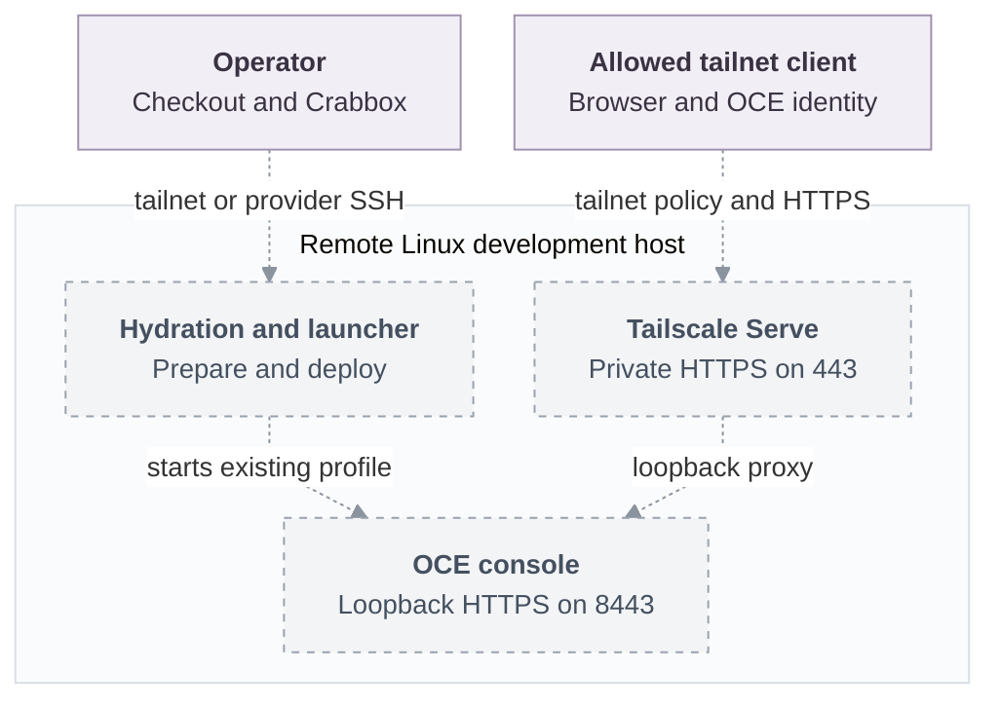

# Proposal: Deploy OCE development environments with Crabbox

- **ID:** RFC-0019
- **Created:** 2026-10-12
- **Last updated:** 2026-10-13
- **RFC PR:** [#2](https://github.com/opencharly/openclaw-enterprise/pull/2)
- **Implementation plan:** [RFC-0019 delivery plan](../plans/0019-crabbox-oce-deployment.md)
- **Source baseline:** Enterprise `3d180654c`; Crabbox `66b66f8`

## Summary

Add repository-defined Crabbox jobs that deploy OpenClaw Enterprise (OCE)'s
existing Kubernetes development profile on a remote Linux host. Crabbox manages
the host, checkout synchronization, and prerequisite setup; `scripts/dev-up`
continues to own platform startup. An optional Tailscale job publishes the console
at the host's private tailnet HTTPS origin.

This RFC proposes the integration. The jobs and browser-origin setting do not
exist yet. It does not establish a production deployment option or change the
RFC's decision status to Accepted.

## Motivation

A developer or operator needs a remote development installation that can stay
available between sessions and be recreated from a checkout. Today,
[Local Setup](../../docs/guides/quickstart.md) requires a prepared machine and
publishes the console on its loopback interface. Remote browser access already
works through the documented [SSH tunnel and development CA](../../docs/guides/operate/troubleshooting.md#open-the-console-from-another-machine).
[Production Kubernetes installation](../../docs/guides/kubernetes-setup.md) is a
separate supported procedure.

The missing convenience is a repository-defined command that prepares a remote
host, starts the development profile, retains it for inspection, and optionally
provides private browser access without configuring a tunnel and CA on each
client. Crabbox supplies the existing host-management mechanism.

## Goals and non-goals

The proposed caller runs `crabbox job run oce-deploy` from the OCE checkout.
`oce-deploy-tailscale` adds private HTTPS console access. Both jobs must support a
fresh lease and explicit reuse with `--id <lease>`.

Scope includes prerequisite hydration, a browser-origin setting in the launcher,
retained leases, explicit teardown, and the documentation needed to use them.
The host must meet the development profile's storage, container-engine, kernel,
and networking requirements; a Crabbox lease alone does not establish suitability.

Production packaging, public internet exposure, Tailscale join logic, model-backed
Agent qualification, and Agent native admin UIs over the tailnet are outside this
proposal. Native admin access needs per-Agent hostnames; a single tailnet machine
name does not provide them.

## Proposed design

### Deployment ownership and lifecycle

A root `.crabbox.yaml` defines two jobs and their teardown profiles. Both hydrate
prerequisites from `.github/workflows/crabbox-hydrate.yml`, install the locked
repository dependencies, build the CLI, and invoke `scripts/dev-up` with the
Kubernetes-only profile. The workflow has a `workflow_dispatch` trigger and is not
added to ordinary CI triggers. Crabbox's default hydration path executes its
supported workflow steps over SSH.

Crabbox owns allocation, sync, hydration, and remote execution. The existing
launcher owns the cluster, database, bootstrap credentials, and startup checks.
The OCE deployment contributors own the job and workflow; the launcher
contributors own origin validation and console behavior. The caller selects an
eligible provider or existing SSH host and owns inspection and cleanup.

Use `stop: never` to retain the lease after success or failure. Provider TTL and
idle limits still apply. This retention policy does not promise indefinite
availability or make startup on an existing lease idempotent. The plan must verify
reuse and document when teardown is required before another start.

### Private console access

The Tailscale job requires `network: tailscale`, which makes Crabbox refuse remote
execution when the caller cannot reach the host over tailnet SSH. For managed
Linux leases, the caller enables Crabbox's Tailscale integration on a provider
that supports it. For the static `ssh` provider, the operator joins the host in
advance and sets `static.host` to its tailnet name. Other providers require their
own verified host preparation; this RFC does not promise universal compatibility.

The job configures Tailscale Serve on port 443 to proxy the loopback HTTPS console
on port 8443. The proposed target is `https+insecure://127.0.0.1:8443`: Serve
validates the client-facing connection with a tailnet certificate but skips the
development certificate check on that loopback hop. This exception must remain
confined to that hop. The API and development console listeners remain on
loopback; Funnel is not used.

The tailnet operator must enable HTTPS certificates and permit the intended
clients. OCE still requires sign-in and exact-resource authorization; tailnet
membership and Serve identity headers do not provision an OCE identity or grant
permissions. Administrator passwords, service keys, and CA private keys remain
in the launcher's protected state directory and must not become job artifacts.

### Launcher contract

Add optional `OCC_DEVELOPMENT_BROWSER_ORIGIN`, initially documented as
`https://<machine>.<tailnet>.ts.net:443`. The explicit port matches the current
console client's origin parser; validation must reject malformed origins before
creating deployment resources.

When set, the launcher must use one consistent external origin for `auth.baseUrl`,
browser-origin checks, relevant sign-in redirects, and the printed console URL.
It must disable `agentNativeAdmin`. When unset, existing launcher behavior remains.

The implementation must also reconcile that external name with ingress host
matching, TLS server names, and the launcher's own HTTPS checks. The current
[`newDevelopmentConsole`](../../internal/occdev/keycloak_k3d.go) trusts only the
development CA and dials loopback; substituting a tailnet origin alone cannot
establish a valid TLS path. The plan tracks this integration decision explicitly.

### Architecture

Dashed arrows show the proposed integration. Existing components do not establish
that the combined deployment or browser path works.

### Failure and cleanup

A job failure must report the failed stage and retained lease ID without exposing
credentials. Retention permits inspection but does not override the launcher's
existing rollback. An unreachable lease cannot be inspected until access returns.
If Serve was configured before startup failed, it may still be configured; the
operator must be able to remove it separately from platform teardown.

The teardown profile uses the same deployment settings and state directory as
startup. `scripts/dev-down` removes the development installation, including its
data and credentials; the Tailscale profile also removes its Serve configuration.
Only then does the caller release the lease with `crabbox stop <lease>`. Resetting
Serve on an existing host can affect other services, so the plan must define an
exclusive-host prerequisite or cleanup limited to the job's configuration.

## Delivery and verification

The [implementation plan](../plans/0019-crabbox-oce-deployment.md) owns ordered
changes, prerequisites, delivery status, and results. Required outcomes are:

- A fresh eligible Linux host reaches the launcher's ready state; authenticated
  `occ installation get` succeeds and the initial Namespace becomes ready.
- Explicit lease reuse has a verified procedure, including recovery after failure.
- An allowed second tailnet device opens the console and signs in; a denied
  tailnet device and a device outside the tailnet cannot use that publication.
- Missing tailnet SSH access prevents the Tailscale job from running remotely.
- Origin validation, redirects, TLS checks, and disabled native admin access agree;
  the unset setting preserves the current local profile.
- Teardown removes the owned deployment and Serve publication, reports failures,
  and permits explicit lease release without collecting credentials as artifacts.

No deployment or tailnet checks have run. Source and documentation review support
this proposal's starting assumptions, not runtime availability or production readiness.

## Rationale and alternatives

- **Retain manual setup and SSH tunneling.** This already supports remote console
  access and avoids a launcher change, but leaves host preparation and each
  browser's tunnel and CA setup to the operator.
- **Expose the development console directly on the tailnet.** This still requires
  client CA setup and changes the listener boundary. Serve keeps that listener on
  loopback and supplies the external certificate.
- **Install the production Helm deployment.** This remains the appropriate route
  for production; it does not provide the requested disposable development flow.
- **Add a separate Tailscale join script.** Reusing Crabbox avoids another owner
  for lease enrollment, auth keys, and release behavior.

## Unresolved questions

- **Deployment scope:** responsible maintainers must determine whether the proposed
  remote development behavior enters the approved milestones in
  [AGENTS.md](../../AGENTS.md#active-workspace-boundary). This PR only authors the proposal.
- **Origin integration:** launcher contributors must select and verify the TLS,
  ingress, and sign-in path described above before delivering the Tailscale job.
- **Host and Serve ownership:** deployment contributors and the tailnet operator
  must select the initial supported Linux image and safe Serve cleanup contract.

## References

- [Specification process](../../docs/contributing/specifications.md) and
  [platform design](../../docs/design.md)
- Published [Local Setup](https://docs-enterprise.openclaw.org/guides/quickstart/)
  and [remote console access](https://docs-enterprise.openclaw.org/guides/operate/troubleshooting/#open-the-console-from-another-machine)
- [`scripts/dev-up`](../../scripts/dev-up), [`scripts/dev-down`](../../scripts/dev-down),
  and [`scripts/ci/setup-tools.sh`](../../scripts/ci/setup-tools.sh)
- Crabbox at `66b66f8`: [jobs](https://github.com/openclaw/crabbox/blob/66b66f8/docs/features/jobs.md),
  [hydration](https://github.com/openclaw/crabbox/blob/66b66f8/docs/features/actions-hydration.md),
  and [Tailscale integration](https://github.com/openclaw/crabbox/blob/66b66f8/docs/features/tailscale.md)
- [Tailscale Serve](https://tailscale.com/docs/features/tailscale-serve)
