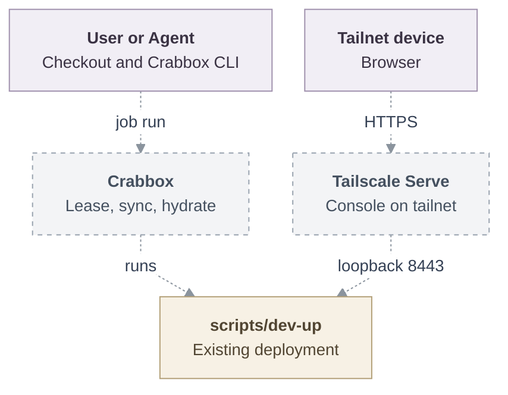

# Proposal: Deploy OCE with Crabbox

- **ID:** RFC-0019
- **Created:** 2026-10-12
- **Last updated:** 2026-10-12
- **RFC PR:** [#2](https://github.com/opencharly/openclaw-enterprise/pull/2)
- **Implementation plan:** None; delivery stays in this RFC
- **Related:** [Local Kubernetes development](../../docs/guides/deploy/local-kubernetes-development.md)
  and [Crabbox](https://github.com/openclaw/crabbox)

<a id="problem-and-decision"></a>

## Summary

`crabbox job run oce-deploy` deploys OCE from the caller's checkout onto any
machine that [Crabbox](https://github.com/openclaw/crabbox) can lease. Crabbox
provides the machine, the checkout, and the tools that OCE's scripts expect.
The existing `scripts/dev-up` does the deployment. With
`oce-deploy-tailscale`, any device on the tailnet can open the OCE console.

## Motivation

OCE's deployment scripts expect a prepared workstation and serve the console
only on its loopback. Crabbox can already lease a self-hosted machine, sync a
checkout, run commands, and forward ports. Combining the two gives a one-step
deployment on hardware a team already has. Tailscale makes that deployment
reachable from every team member's device.

<a id="scope"></a>

## Goals

- One Crabbox job deploys OCE onto a machine that has only Crabbox's
  prerequisites installed.
- One Crabbox job publishes the OCE console on the tailnet.

## Non-goals

- Changing what OCE's deployment scripts do, apart from the browser origin
  setting below.
- Agent native admin UIs over the tailnet. They need per-Agent wildcard
  hostnames, which a tailnet machine name cannot provide.

<a id="design"></a>

## Proposal

### Crabbox deployment

The repository-root `.crabbox.yaml` defines the deployment. Crabbox-specific
files carry `crabbox` in their name, and objects in `.crabbox.yaml` use the
`oce-` prefix.

```yaml
profiles:
  oce:
    presets:
      oce-teardown: { command: scripts/dev-down }
  oce-tailscale:
    presets:
      oce-teardown: { shell: true, command: "scripts/dev-down && sudo tailscale serve reset" }
jobs:
  oce-deploy: &oce-deploy
    target: linux
    profile: oce
    hydrate: { actions: true }
    actions: { workflow: .github/workflows/crabbox-hydrate.yml, job: hydrate }
    shell: true
    command: corepack pnpm install --frozen-lockfile && corepack pnpm cli:build && scripts/dev-up
    stop: never
  oce-deploy-tailscale:
    <<: *oce-deploy
    profile: oce-tailscale
    network: tailscale
    command: >
      corepack pnpm install --frozen-lockfile && corepack pnpm cli:build &&
      sudo tailscale serve --bg --https=443 https+insecure://127.0.0.1:8443 &&
      OCC_DEVELOPMENT_BROWSER_ORIGIN="https://$(tailscale status --json |
      yq -p json '.Self.DNSName | sub("\\.$"; "")')" scripts/dev-up
```

The job runs in three steps:

1. **Lease and sync.** Crabbox leases the machine from the caller's configured
   provider and syncs the checkout.
2. **Prerequisites, once per lease.** Crabbox Actions hydration runs
   `crabbox-hydrate.yml` on the machine. The workflow has only a
   `workflow_dispatch` trigger, so OCE CI never runs it. It installs what
   OCE's scripts expect but do not install themselves:
   - Docker, through `apt-get install docker.io`, with the lease user added
     to `docker`;
   - Node.js, through `actions/setup-node` with the version pinned in `ci.yml`;
   - Go, through `actions/setup-go` with the version in `go.mod`;
   - kubectl, k3d, Helm, and yq, through `scripts/ci/setup-tools.sh k3d`.

   It then writes Crabbox's readiness marker. Its env file sets the
   Kubernetes-only `OCC_DEVELOPMENT_*` selections, `OCC_URL`, and
   `OCC_SERVICE_KEY_FILE` for every later Crabbox command.
3. **Deploy.** The job builds the CLI and runs `scripts/dev-up`, as the
   [local setup](../../docs/guides/quickstart.md) does.

`stop: never` keeps the lease after the job ends. Any Crabbox SSH provider
works, including `ssh` for an existing host, `proxmox`, `xcp-ng`, `incus`
virtual machines, `multipass`, `kubevirt`, and `external`.

### Tailscale access

Crabbox's [Tailscale support](https://github.com/openclaw/crabbox/blob/main/docs/features/tailscale.md)
puts the machine on the tailnet; this RFC adds no join logic of its own:

- **Managed cloud leases** on a provider with Crabbox Tailscale support, such
  as `hetzner`, `aws`, `azure`, or `gcp`: the caller enables
  `tailscale.enabled` (`CRABBOX_TAILSCALE=1`). Crabbox installs Tailscale,
  joins with its default tags and `crabbox-{slug}` hostname, and logs the
  machine out on `crabbox stop`.
- **Existing hosts** on the `ssh` provider: the host is already on the tailnet,
  and `static.host` is its MagicDNS name. Self-hosted virtual machines join
  their tailnet this way, because Crabbox does not join `proxmox`, `xcp-ng`,
  `kubevirt`, `incus`, or `multipass` leases.

`network: tailscale` makes the job fail unless Crabbox reaches the machine over
the tailnet, so the console is never published on a machine outside it.

Crabbox does not use Tailscale Serve, so that step is the job's own. The job
publishes the loopback console proxy with
`tailscale serve --bg --https=443 https+insecure://127.0.0.1:8443` and passes
the machine's tailnet origin, `https://<machine>.<tailnet>.ts.net`, to
`dev-up`. The `oce-tailscale` teardown preset resets Serve.

`dev-up` gains one optional setting, `OCC_DEVELOPMENT_BROWSER_ORIGIN`. When it
is set, the launcher:

- uses that origin as `auth.baseUrl` in place of
  `https://console.<cluster>.oce.localhost:8443`;
- disables `agentNativeAdmin`;
- prints `<origin>/console/` as the console URL.

Tailscale Serve terminates TLS with the tailnet certificate and forwards to
the existing loopback console proxy. When the setting is unset, the launcher
does not change.

### Access

| Task    | Command                                                                                                     |
| ------- | ----------------------------------------------------------------------------------------------------------- |
| Deploy  | `crabbox job run oce-deploy`, or `crabbox job run oce-deploy-tailscale`                                     |
| Console | Open `https://<machine>.<tailnet>.ts.net/console/` on any tailnet device                                    |
| Tunnel  | Without Tailscale: `crabbox tunnel --id <lease> --local-port 8443 8443`, then open the printed URL          |
| Sign in | `crabbox connect <lease>`, then read the printed password file                                              |
| CLI     | `crabbox run --id <lease> --no-sync -- ./bin/occ namespace list`                                            |
| Remove  | `crabbox run --id <lease> --no-sync --profile <profile> --preset oce-teardown`, then `crabbox stop <lease>` |

Credentials stay in the launcher's state directory on the machine. Tailscale
Serve publishes the console only on the tailnet, never through Funnel, so
tailnet ACLs and OCE sign-in both apply. Crabbox handles the Tailscale auth
key and never forwards it to the job.

### Architecture

Dashed arrows are proposed; solid arrows exist today.



## Delivery and verification

Delivery status: Not started.

1. Add `OCC_DEVELOPMENT_BROWSER_ORIGIN` to the launcher.
2. Add `.crabbox.yaml` and `crabbox-hydrate.yml`.
3. Verify on a bare VM: `oce-deploy-tailscale` succeeds, and a second tailnet
   device opens the console and signs in. Repeat on an existing tailnet host
   through the `ssh` provider.

<a id="alternatives-and-open-decisions"></a>

## Rationale and alternatives

- **Serve the console on a tailnet port with the development CA.** Every
  device would have to trust that CA. Tailscale Serve uses the tailnet's own
  certificate.
- **A Crabbox-specific join script.** It would duplicate Crabbox's
  installation, auth key handling, and logout, and it would bypass
  `network: tailscale`.

## References

- [`scripts/dev-up`](../../scripts/dev-up) and
  [`scripts/ci/setup-tools.sh`](../../scripts/ci/setup-tools.sh)
- Crabbox [jobs](https://github.com/openclaw/crabbox/blob/main/docs/features/jobs.md),
  [Actions hydration](https://github.com/openclaw/crabbox/blob/main/docs/features/actions-hydration.md),
  and [configuration](https://github.com/openclaw/crabbox/blob/main/docs/features/configuration.md)
- [Tailscale Serve](https://tailscale.com/kb/1312/serve)
