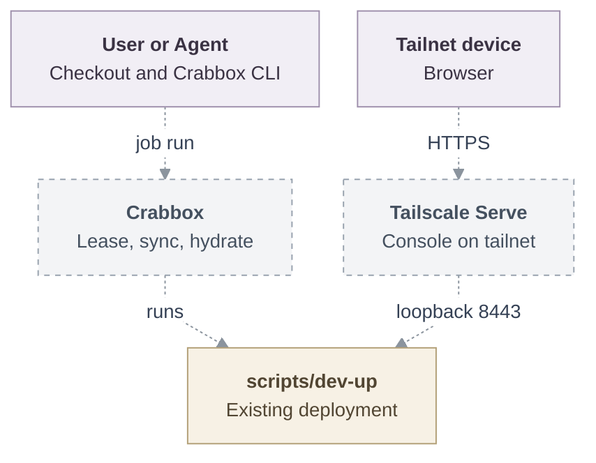

# Proposal: Deploy OCE with Crabbox

- **ID:** RFC-0019
- **Created:** 2026-10-12
- **Last updated:** 2026-10-13
- **RFC PR:** [#2](https://github.com/opencharly/openclaw-enterprise/pull/2)
- **Implementation plan:** None; delivery stays in this RFC
- **Related:** [Local Kubernetes development](../../docs/guides/deploy/local-kubernetes-development.md)
  and [Crabbox](https://github.com/openclaw/crabbox)

<a id="problem-and-decision"></a>

## Summary

`crabbox job run oce-deploy` deploys OCE from the caller's checkout onto any
machine that [Crabbox](https://github.com/openclaw/crabbox) can lease. Crabbox
provides the machine, the checkout, and the tools that OCE's scripts expect.
The existing `scripts/dev-up` does the deployment. With
`oce-deploy-tailscale`, any device on the tailnet can open the OCE console.

## Motivation

OCE's deployment scripts expect a prepared workstation and serve the console
only on its loopback. Crabbox can already lease a self-hosted machine, sync a
checkout, run commands, and forward ports. Combining the two gives a one-step
deployment on hardware a team already has. Tailscale makes that deployment
reachable from every team member's device.

<a id="scope"></a>

## Goals

- One Crabbox job deploys OCE onto a machine that has only Crabbox's
  prerequisites installed.
- One Crabbox job publishes the OCE console on the tailnet.

## Non-goals

- Changing what OCE's deployment scripts do, apart from the browser origin
  setting below.
- Agent native admin UIs over the tailnet. They need per-Agent wildcard
  hostnames, which a tailnet machine name cannot provide.

<a id="design"></a>

## Proposal

### Crabbox deployment

The repository-root `.crabbox.yaml` defines the deployment. Crabbox-specific
files carry `crabbox` in their name, and objects in `.crabbox.yaml` use the
`oce-` prefix.

```yaml
profiles:
  oce:
    presets:
      oce-teardown: { command: scripts/dev-down }
  oce-tailscale:
    presets:
      oce-teardown: { shell: true, command: "scripts/dev-down && sudo tailscale serve reset" }
jobs:
  oce-deploy: &oce-deploy
    target: linux
    profile: oce
    hydrate: { actions: true }
    actions: { workflow: .github/workflows/crabbox-hydrate.yml, job: hydrate }
    shell: true
    command: corepack pnpm install --frozen-lockfile && corepack pnpm cli:build && scripts/dev-up
    stop: never
  oce-deploy-tailscale:
    <<: *oce-deploy
    profile: oce-tailscale
    network: tailscale
    command: >
      corepack pnpm install --frozen-lockfile && corepack pnpm cli:build &&
      sudo tailscale serve --bg --https=443 https+insecure://127.0.0.1:8443 &&
      OCC_DEVELOPMENT_BROWSER_ORIGIN="https://$(tailscale status --json |
      yq -p json '.Self.DNSName | sub("\\.$"; "")')" scripts/dev-up
```

The job runs in three steps:

1. **Lease.** Crabbox leases the machine from the caller's configured
   provider, and keeps it (`stop: never`). Checkout sync belongs to the
   hydration and run steps below.
2. **Prerequisites, once per lease.** Crabbox Actions hydration runs
   `crabbox-hydrate.yml` on the machine. The workflow has only a
   `workflow_dispatch` trigger, so OCE CI never runs it, and it declares the
   `crabbox_id`, `crabbox_runner_label`, and `crabbox_keep_alive_minutes`
   inputs that Crabbox requires of a workflow it inspects. It installs what
   OCE's scripts expect but do not install themselves:
   - Docker, through `apt-get install docker.io` on a lease image without it,
     with the lease user added to `docker`;
   - Node.js, through `actions/setup-node` with the version pinned in `ci.yml`;
   - Go, through a `run:` step that installs the version in `go.mod`: on
     Crabbox's local hydration path `actions/setup-go` only verifies an
     installed Go, and fails with "install Go in a run step or prebuild the
     Crabbox image" when the image has none;
   - kubectl, k3d, Helm, and yq, through `scripts/ci/setup-tools.sh k3d`.

   Those four tools install into `$RUNNER_TEMP/bin`, which reaches a later
   Crabbox command only through the env file: Crabbox persists the Node and
   pnpm tool-cache paths itself, so the workflow also exports the tool
   directory on `PATH` there. The launcher requires `k3d`, `kubectl`, `helm`,
   and, with the `none` Sandbox Driver, `node` on `PATH`.

   It then writes Crabbox's readiness marker. Its env file sets the
   Kubernetes-only `OCC_DEVELOPMENT_COMPUTE_DRIVER=kubernetes`,
   `OCC_DEVELOPMENT_CONTROL_PLANE=kubernetes`,
   `OCC_DEVELOPMENT_SANDBOX_DRIVER=none`, and
   `OCC_DEVELOPMENT_STATE_DIRECTORY` selections, plus `OCC_URL` and
   `OCC_SERVICE_KEY_FILE`, for the later Crabbox commands that source it.

3. **Deploy.** Crabbox syncs the checkout, the job builds the CLI, and runs
   `scripts/dev-up`, as the
   [local setup](../../docs/guides/quickstart.md) does.

`stop: never` keeps the lease after the job ends. Any Crabbox SSH provider
works, including `ssh` for an existing host, `proxmox`, `xcp-ng`, `incus`
virtual machines, `multipass`, `kubevirt`, and `external`.

### Tailscale access

Crabbox's [Tailscale support](https://github.com/openclaw/crabbox/blob/main/docs/features/tailscale.md)
puts the machine on the tailnet; this RFC adds no join logic of its own:

- **Managed cloud leases** on a provider with Crabbox Tailscale support, such
  as `hetzner`, `aws`, `azure`, or `gcp`: the caller enables
  `tailscale.enabled` (`CRABBOX_TAILSCALE=1`). Crabbox installs Tailscale,
  joins with its default tags and `crabbox-{slug}` hostname, and logs the
  machine out on `crabbox stop`, best-effort while SSH is still reachable.
- **Existing hosts** on the `ssh` provider: the host is already on the tailnet,
  and `static.host` is its MagicDNS name. Self-hosted virtual machines join
  their tailnet this way, because Crabbox does not join `proxmox`, `xcp-ng`,
  `kubevirt`, `incus`, or `multipass` leases.

`network: tailscale` makes the job fail unless Crabbox reaches the machine over
the tailnet, so the job only runs where the tailnet is already the path. The
console itself is published only on the node `tailscale serve` runs on.

Crabbox does not use Tailscale Serve for its managed leases, so that step is
the job's own. The job
publishes the loopback console proxy with
`tailscale serve --bg --https=443 https+insecure://127.0.0.1:8443` and passes
the machine's tailnet origin, `https://<machine>.<tailnet>.ts.net`, to
`dev-up`. The `oce-tailscale` teardown preset resets Serve.

`dev-up` gains one optional setting, `OCC_DEVELOPMENT_BROWSER_ORIGIN`. When it
is set, the launcher:

- uses that origin as `auth.baseUrl` in place of
  `https://console.<cluster>.oce.localhost:8443`, and as the Console origin
  the launcher checks and the sign-in redirect host it derives today from
  `console.<cluster>.oce.localhost`;
- disables `agentNativeAdmin`;
- prints `<origin>/console/` as the console URL.

The launcher accepts an `https` origin only when it names a port, so the job
passes `https://<machine>.<tailnet>.ts.net:443`.

Tailscale Serve terminates TLS with the tailnet certificate and forwards to
the existing loopback console proxy. When the setting is unset, the launcher
does not change.

### Access

| Task    | Command                                                                                                                                                      |
| ------- | ------------------------------------------------------------------------------------------------------------------------------------------------------------ |
| Deploy  | `crabbox job run oce-deploy`, or `crabbox job run oce-deploy-tailscale`                                                                                      |
| Console | Open `https://<machine>.<tailnet>.ts.net/console/` on any tailnet device                                                                                     |
| Tunnel  | Without Tailscale: `crabbox tunnel --id <lease> --local-port 8443 8443`, then open `https://127.0.0.1:<local-port>/console/` with the development CA trusted |
| Sign in | `crabbox connect <lease>`, then read the administrator password file printed by the launcher                                                                 |
| CLI     | `crabbox run --id <lease> -- ./bin/occ namespace list`                                                                                                       |
| Remove  | `crabbox run --id <lease> --no-sync --profile <profile> --preset oce-teardown`, then `crabbox stop <lease>`                                                  |

Credentials stay in the launcher's state directory on the machine, which
defaults beneath the temporary directory. Tailscale
Serve publishes the console only on the tailnet, never through Funnel, so
tailnet ACLs and OCE sign-in both apply. Crabbox handles the Tailscale auth
key and never forwards it to the job.

### Architecture

Every arrow below is proposed; none of these connections exists today.



## Delivery and verification

Delivery status: Planned.

1. Add `OCC_DEVELOPMENT_BROWSER_ORIGIN` to the launcher, and record the
   setting in the development settings reference and the environment-variable
   cheat sheet.
2. Add `.crabbox.yaml` and `crabbox-hydrate.yml`.
3. Verify on a bare VM that has the local Kubernetes profile's storage and
   free ports (about 20 GB of engine storage, and free 3000, 8443, and 6443):
   `oce-deploy-tailscale` succeeds, and a second tailnet device opens the
   console and signs in. Repeat on an existing tailnet host through the `ssh`
   provider.

Required outcomes and evidence: a second device opens
`https://<machine>.<tailnet>.ts.net/console/` and signs in, while a device
outside the tailnet cannot reach it; the job refuses to run when Crabbox
cannot reach the lease over the tailnet; the `oce-tailscale` teardown preset
removes the deployment and resets Serve.

Not yet verified: none of this has run. Reading establishes the Crabbox
configuration and the launcher's contracts, not that this stack comes up on a
leased machine; the bare-VM run above is the first proof, and the tailnet must
already serve HTTPS certificates for `tailscale serve --https=443`.

<a id="alternatives-and-open-decisions"></a>

## Rationale and alternatives

- **Serve the console on a tailnet port with the development CA.** Every
  device would have to trust that CA. Tailscale Serve uses the tailnet's own
  certificate.
- **A Crabbox-specific join script.** It would duplicate Crabbox's
  installation, auth key handling, and logout, and it would bypass
  `network: tailscale`.
- **Keep the local profile as the only deployment.** Teams keep preparing a
  workstation by hand, and the console stays on that workstation's loopback.

## Unresolved questions

- **Milestone scope.** Deployment behavior is outside the approved milestones
  in `AGENTS.md`; the responsible maintainers decide whether it enters them,
  and nothing here is implemented before that decision.
- **The origin shape.** The launcher accepts an `https` Console origin only
  when it names a port. The launcher owner decides whether the job keeps
  passing `:443` or the launcher admits a tailnet name without one.
- **Docker on the lease.** The deployment-config owner decides whether the
  hydration workflow installs Docker or asserts the lease image already has
  it, as Crabbox's own Linux builder image does. A host outside the Debian
  family needs its own setup.
- **A static host's permissions.** On the `ssh` provider, the tailnet operator
  must already have joined the host, and the lease user needs working `sudo`
  for `tailscale serve`.

## References

- [`scripts/dev-up`](../../scripts/dev-up) and
  [`scripts/ci/setup-tools.sh`](../../scripts/ci/setup-tools.sh)
- Crabbox [jobs](https://github.com/openclaw/crabbox/blob/main/docs/features/jobs.md),
  [Actions hydration](https://github.com/openclaw/crabbox/blob/main/docs/features/actions-hydration.md),
  and [configuration](https://github.com/openclaw/crabbox/blob/main/docs/features/configuration.md)
- [Tailscale Serve](https://tailscale.com/docs/features/tailscale-serve)
