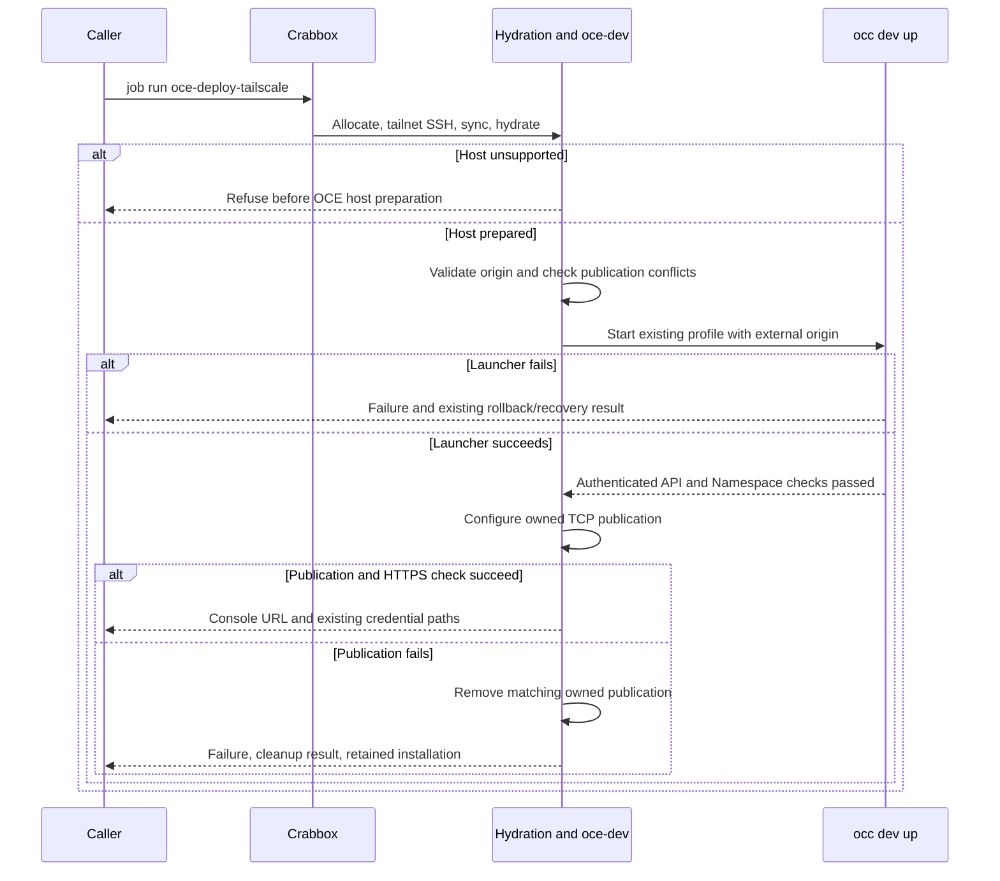

# Proposal: Deploy OCE development environments with Crabbox

- **ID:** RFC-0019
- **Created:** 2026-10-12
- **Last updated:** 2026-10-13
- **RFC PR:** [opencharly/openclaw-enterprise#2](https://github.com/opencharly/openclaw-enterprise/pull/2)
- **Implementation plan:** [RFC-0019 implementation plan](../plans/0019-crabbox-oce-deployment.md)
- **Source baseline:** Enterprise `3d180654c`; [Crabbox](https://github.com/openclaw/crabbox) `3d9260e7`; Tailscale `v1.104.1`

<a id="problem-and-decision"></a>

## Summary

Add three [Crabbox jobs](https://github.com/openclaw/crabbox/blob/3d9260e7a37e025ed36b3c38fbcf1ae50e4a3520/docs/features/jobs.md)
that run OpenClaw Enterprise (OCE)'s existing Kubernetes-only development profile
on a remote Linux host. `oce-deploy` prepares the host and starts the profile.
`oce-deploy-tailscale` also publishes the normal console at the host's private
HTTPS name. `oce-teardown` removes the installation and its Serve publication.

Add one optional launcher setting, `OCC_DEVELOPMENT_BROWSER_ORIGIN`, for the
external browser origin. Users authenticate and use the console exactly as in
the selected local profile; tailnet access supplies the network path.

## Motivation

Contributors want a development installation on a cloud lease or their own
server, with a console they can open from their devices.
[Local Setup](../../docs/guides/quickstart.md) assumes a prepared machine and
publishes the console on loopback. Remote clients currently use a
[tunnel and development CA](../../docs/guides/operate/troubleshooting.md#open-the-console-from-another-machine).
A repository-defined job would prepare the host and make repeated development
installations easier to run.

<a id="scope"></a>

## Goals

Each goal is required; the plan maps it to implementation and verification.

1. A fresh managed lease or static host reaches launcher readiness, authenticated
   `occ installation get` succeeds, and the initial Namespace is ready. Refuse an
   unsupported host before OCE hydration changes packages or host settings;
   Crabbox allocation, bootstrap, and checkout sync precede this check.
2. A permitted tailnet device opens the ordinary login page without trusting a
   custom CA. Sign-in uses the same OCE credentials, sessions, authorization, and
   logout as local setup. Public login assets remain public; protected requests
   have the same authentication and permission requirements. Denied and
   off-tailnet devices cannot reach the publication.
3. The Tailscale job refuses remote execution without tailnet SSH access and
   refuses startup without a certificate-eligible host name. Failed certificate
   issuance or HTTPS checks make the deployment job fail and trigger cleanup.
4. Reject an invalid origin or unsupported profile before launcher deployment
   effects, through every startup entry point. Unset behavior stays unchanged.
5. Remove only the owned installation and Serve publication. On any failed
   deployment, including publication checks, remove the owned publication and
   report surviving installation state. Preserve recovery records and the lease
   on cleanup failure, subject to the lease's expiry policy.
6. Keep credential values out of logs and artifacts.

[AGENTS.md](../../AGENTS.md#active-workspace-boundary) limits deployment behavior
to approved milestones. Acceptance by responsible maintainers must explicitly
admit this development-tooling scope; this proposal does not establish acceptance.

## Non-goals

- Production installation, public exposure through Funnel, or new authentication.
- Keycloak sign-in, OpenShell, or native Agent admin through the tailnet. This
  first delivery selects the default password-only local profile; the optional
  profiles and per-Agent native hostnames need separate qualification.
- Tailnet enrollment, concurrent installations on one host, or platforms other
  than Ubuntu 24.04/26.04 amd64.

<a id="design"></a>

## Proposal

| Owner                           | Responsibility                                                                                    |
| ------------------------------- | ------------------------------------------------------------------------------------------------- |
| Caller                          | Provider, lease, tailnet preparation, and explicit teardown                                       |
| Crabbox                         | Allocation, checkout sync, local Actions hydration, SSH, and release                              |
| Hydration workflow (new)        | Host checks, Docker, and toolchain                                                                |
| `scripts/crabbox/oce-dev` (new) | Fixed profile environment, launcher calls, checks, and owned Serve configuration                  |
| Launcher                        | Origin validation, cluster, credentials, startup checks, and rollback                             |
| Tailnet operator                | Certificate eligibility, access policy, and exclusive configuration changes during job operations |

### Hosts and lifetime

Each dedicated host runs one installation. Hydration installs missing tools and
applies the documented [Codex sandbox sysctl](../../docs/guides/operate/troubleshooting.md#local-codex-sandbox-check-fails).
Teardown removes installation data, credentials, and publication; installed tools,
Docker group membership, and the documented host sysctl remain.

Managed leases follow Crabbox's [lease policy](https://github.com/openclaw/crabbox/blob/3d9260e7a37e025ed36b3c38fbcf1ae50e4a3520/docs/features/lifecycle-cleanup.md).
The jobs request four hours, subject to policy clamping and expiry; keeping a
lease does not extend its lifetime. Use a static host for persistent development.

<a id="console-origin"></a>

### Console origin and authentication

`OCC_DEVELOPMENT_BROWSER_ORIGIN` accepts a normalized HTTPS origin with a host
and optional valid port, without credentials, query, fragment, or a non-root
path. It is supported only with Kubernetes-only control plane, sandbox `none`,
and default password sign-in. The launcher sets `auth.baseUrl`, omits
`agentNativeAdmin`, and prints `<origin>/console/`.

Existing browser-origin and session checks use that origin; OCE authentication
and authorization rules remain unchanged. The login page remains available
before sign-in. Tailnet membership does not enroll an OCE account or grant access.
Bootstrap password and service-key files remain in the private launcher state.

Password-only startup does not call the console over HTTPS;
[`newDevelopmentConsole`](../../internal/occdev/keycloak_k3d.go) belongs to the
excluded Keycloak flow. The existing development browser proxy terminates TLS
and forwards HTTP to the API. It requires no ingress hostname change. The API
normalizes `auth.baseUrl` using `URL.origin`, so default HTTPS needs no `:443`.

### Tailnet publication

Derive the external origin from the machine's certificate-eligible MagicDNS name.
Use [TLS-terminated TCP forwarding](https://tailscale.com/docs/reference/tailscale-cli/serve#use-a-tcp-forwarder)
to the existing loopback HTTP API, which also serves `/console/`:

```sh
sudo tailscale serve --bg --tls-terminated-tcp=443 tcp://127.0.0.1:3000
```

Tailscale supplies the external certificate and forwards decrypted bytes over
loopback. Its [TCP path](https://github.com/tailscale/tailscale/blob/v1.104.1/ipn/ipnlocal/serve.go#L687)
does not inject HTTP forwarding or identity headers. Do not enable PROXY protocol,
HTTP reverse-proxy mode, or Funnel. This preserves OCC's existing refusal of
untrusted forwarded headers without adding proxy trust or skipping a certificate
check. The local HTTPS console on port 8443 remains available to the base job's
SSH-tunnel procedure.

The job must refuse conflicting Serve or Funnel configuration on port 443,
preserve unrelated configuration and operator replacements, and remove only its
own matching publication. Interrupted or uncertain operations must leave enough
information for safe recovery. The plan owns delivery; record formats and shell
mechanics are implementation choices.

### Lifecycle

This sequence is proposed. The base job omits Serve operations.



Deploy jobs retain the lease for inspection. A reused installation needs teardown
before another start. Use `crabbox job run --id <lease> oce-teardown`; omit `--id`
and Crabbox allocates another lease instead. Use `--stop never` for teardown when
redeploying on that lease. Otherwise release follows successful removal of both
owned resources. Cleanup failure retains recovery records and suppresses release.

## Delivery and verification

The wrapper reuses launcher validation, authenticated readiness, state ownership,
and rollback. Publish Serve only after startup succeeds; failures before that
point create no publication to clean up. Reuse existing tool installers and
Crabbox's retained environment rather than adding parallel setup mechanisms.

The [plan](../plans/0019-crabbox-oce-deployment.md) owns concrete changes and the
check for each goal. Nothing is implemented or runtime-qualified yet. Source
review establishes the selected contracts, not a successful remote installation.

<a id="alternatives-and-open-decisions"></a>

## Rationale and alternatives

- **Manual setup and SSH tunnel:** works today, but each client needs a tunnel
  and development CA.
- **Serve HTTP reverse proxy:** adds forwarded headers, which OCC rejects unless
  proxy trust is configured. TCP forwarding avoids changing that admission policy.
- **Serve without the origin setting:** the browser's tailnet origin fails OCE's
  existing origin checks.
- **Direct tailnet listener:** changes the loopback boundary and still requires
  client CA trust.
- **Separate provisioning script:** duplicates Crabbox's lease and hydration work.

## References

- [Specification process](../../docs/contributing/specifications.md)
- [Development settings](../../docs/reference/settings/development.md)
- [Local Setup](https://docs-enterprise.openclaw.org/guides/quickstart/)
