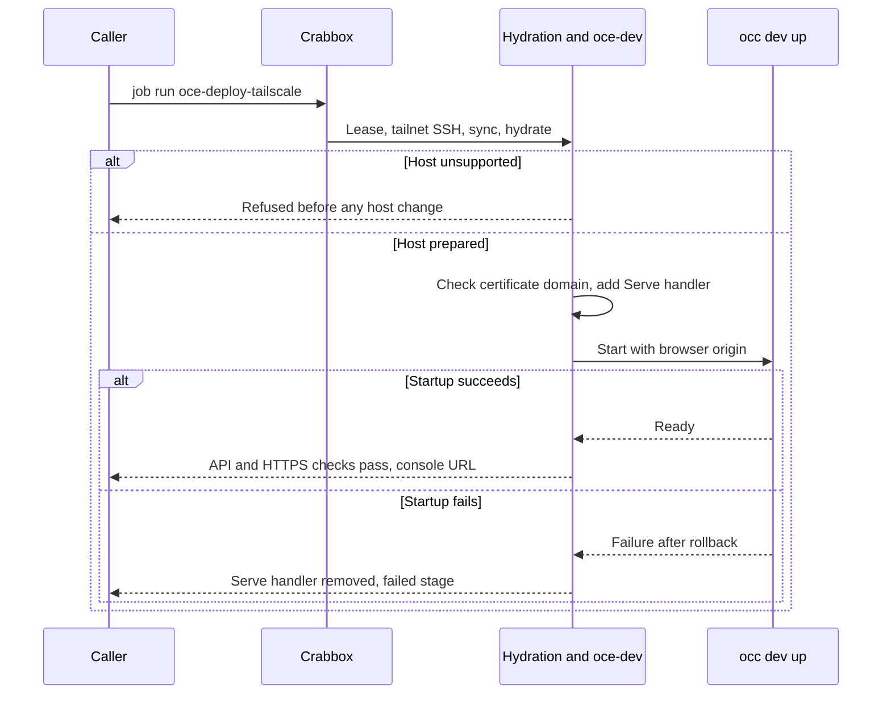

# Proposal: Deploy OCE development environments with Crabbox

- **ID:** RFC-0019
- **Created:** 2026-10-12
- **Last updated:** 2026-10-13
- **RFC PR:** [opencharly/openclaw-enterprise#2](https://github.com/opencharly/openclaw-enterprise/pull/2)
- **Implementation plan:** [RFC-0019 implementation plan](../plans/0019-crabbox-oce-deployment.md)
- **Related:** verified against Enterprise `3d180654c` and [Crabbox](https://github.com/openclaw/crabbox) `3d9260e7`

<a id="problem-and-decision"></a>

## Summary

Add three [Crabbox jobs](https://github.com/openclaw/crabbox/blob/3d9260e7a37e025ed36b3c38fbcf1ae50e4a3520/docs/features/jobs.md)
that run OpenClaw Enterprise (OCE)'s existing Kubernetes-only development profile
on a remote Linux host. `oce-deploy` prepares the host and starts the profile.
`oce-deploy-tailscale` also serves the console at the host's tailnet HTTPS name.
`oce-teardown` removes what both jobs created.

The only product change is an optional launcher setting,
`OCC_DEVELOPMENT_BROWSER_ORIGIN`, which selects the browser origin the
installation accepts.

## Motivation

Contributors want a development installation on a cloud lease or on a server
they own, and they want to open its console from their own devices.
[Local Setup](../../docs/guides/quickstart.md) assumes a machine that is already
prepared, and it serves the console only on that machine's loopback interface.
Any other client needs a
[tunnel and a copy of the development CA](../../docs/guides/operate/troubleshooting.md#open-the-console-from-another-machine).
No repository-defined command prepares a host or repeats a deployment.

<a id="scope"></a>

## Goals

Each goal is a required outcome. The plan pairs each one with its checks.

1. `oce-deploy` brings a fresh managed lease or a static host to the launcher's
   ready state, and `occ installation get` then succeeds. An unsupported host is
   refused before anything on it changes.
2. Any tailnet device that the tailnet policy permits can sign in over HTTPS
   without trusting a custom CA. A denied device, an off-tailnet device, and an
   unauthenticated request all fail.
3. The Tailscale job refuses to run when Crabbox cannot reach the host over the
   tailnet. It fails before startup when the tailnet has no HTTPS certificates.
4. An invalid origin fails before any effect. When the setting is unset, local
   behavior does not change.
5. Teardown removes only what the jobs created. It reports a partial failure and
   keeps the lease when teardown fails.
6. No log or artifact contains a credential.

[AGENTS.md](../../AGENTS.md#active-workspace-boundary) admits deployment
behavior only within approved milestones. This RFC adds development tooling, not
a platform resource or a production path, so accepting it admits that tooling.

## Non-goals

- Production installation, or public exposure through Tailscale Funnel.
- Keycloak sign-in, the OpenShell profile, or native Agent admin over the
  tailnet. Each of these depends on names that only the host can resolve.
- Tailnet enrollment, more than one installation per host, or hosts other than
  Ubuntu on amd64.

<a id="design"></a>

## Proposal

| Owner                                         | Responsibility                                                          |
| --------------------------------------------- | ----------------------------------------------------------------------- |
| Caller                                        | Crabbox provider, lease, tailnet join, and teardown                     |
| Crabbox                                       | Lease, checkout sync, local Actions hydration, SSH, and release         |
| `.github/workflows/crabbox-hydrate.yml` (new) | Host checks, Docker, and toolchain                                      |
| `scripts/crabbox/oce-dev` (new)               | Profile environment, launcher calls, and its own Serve handler          |
| Launcher (`occ dev up/down`)                  | Cluster, credentials, startup checks, and rollback; otherwise unchanged |
| Tailnet operator                              | HTTPS certificates and the access policy                                |

### Hosts and lifetime

Each host runs Ubuntu 24.04 or 26.04 on amd64 and serves a single installation.
It can be a Crabbox-managed Linux lease or a static SSH host. Because the host
is dedicated, hydration may make two host-wide changes that the guides already
document: it installs Docker and applies the
[Codex sandbox sysctl](../../docs/guides/operate/troubleshooting.md#local-codex-sandbox-check-fails).
Managed leases expire under Crabbox's
[lease policy](https://github.com/openclaw/crabbox/blob/3d9260e7a37e025ed36b3c38fbcf1ae50e4a3520/docs/features/lifecycle-cleanup.md),
which defaults to a four-hour maximum. A long-lived environment needs a static
host.

<a id="console-origin"></a>

### Console origin

`OCC_DEVELOPMENT_BROWSER_ORIGIN` takes a bare `https` origin. It is valid only
with the Kubernetes-only profile, the `none` sandbox driver, and password
sign-in. When it is set, the launcher sets `auth.baseUrl` to the origin, omits
`agentNativeAdmin`, and prints `<origin>/console/` as the console URL. The
installation then accepts no other browser origin.

No TLS or ingress change is needed:

- With password sign-in, the launcher never calls the console over HTTPS. Only
  Keycloak sign-in does so, through
  [`newDevelopmentConsole`](../../internal/occdev/keycloak_k3d.go).
- The console port is a TLS passthrough to the API
  ([`openshell_k3d.go`](../../internal/occdev/openshell_k3d.go)).
- The API compares the request's `Origin` with `new URL(auth.baseUrl).origin`
  ([`auth/index.ts`](../../apps/controller/src/auth/index.ts)). That expression
  drops the default port, so the origin needs no `:443`.

For the Tailscale job, `oce-dev` derives the origin from the host's MagicDNS
name. Before startup it adds a
[Tailscale Serve](https://tailscale.com/docs/reference/tailscale-cli/serve)
handler:

```sh
sudo tailscale serve --bg --https=443 https+insecure://127.0.0.1:8443
```

Serve presents the tailnet certificate. It skips certificate verification only
on the loopback hop to the development certificate. Listeners stay on loopback,
so the tailnet policy decides which devices connect. OCE still requires sign-in
for every request. Credentials stay in the launcher's private state directory,
and no job collects artifacts.

### Lifecycle

The sequence below is the proposed flow. `oce-deploy` omits the Serve steps.



Deploy jobs never stop the lease, so the caller can inspect the host after a
success or a failure. The launcher refuses to start over an existing
installation, so a reused lease needs a teardown first. `oce-teardown` removes
only the recorded Serve handler, using `tailscale serve … off`, and the
installation. It releases the lease only when both removals succeed.

## Delivery and verification

The [implementation plan](../plans/0019-crabbox-oce-deployment.md) owns the
ordered work, the checks for each goal, and their results. None of those checks
has run.

<a id="alternatives-and-open-decisions"></a>

## Rationale and alternatives

- **Keep manual setup and the tunnel.** This needs no code, but every caller
  repeats host preparation and CA trust.
- **Use Serve without the launcher setting.** Sign-in fails, because the
  `*.ts.net` browser origin does not match the installation's `.localhost`
  origin.
- **Bind the console to the tailnet interface.** This breaks the loopback-only
  rule for development listeners, and clients would still need the CA.
- **Write a separate provisioning script.** Crabbox already owns leases,
  hydration, tailnet enrollment, and release.

## References

- [Specification process](../../docs/contributing/specifications.md)
- [Development settings](../../docs/reference/settings/development.md)
